# slopcheck

**Catch what AI coding assistants get wrong before it ships:** packages that don't exist, look-alikes of popular libraries, packages already known to be malware, vulnerable versions deep in your lockfile, leaked API keys, and the security slips that appear in generated code again and again. One command. Zero dependencies.

[](https://github.com/njuj/slopcheck/actions/workflows/ci.yml)


<p align="center"></p>

<p align="center"></p>

## The problem: slopsquatting

LLMs regularly recommend packages that **do not exist**. In [a study of 576,000 code samples from 16 models](https://arxiv.org/abs/2406.10279), almost 20% of the recommended packages were hallucinated, and the same fake names came back again and again. Repeated fake names are predictable, so an attacker can register them on PyPI or npm and wait for someone to paste `pip install` from a chat window. The attack is called **slopsquatting**.

Plain typos (`reqeusts`), import names used as package names (`pip install cv2`) and decorated look-alikes (`python-openai`) open the same door. None of these fail loudly: they install whatever happens to own the name.

## What it looks like

```text
$ slopcheck my-vibe-app/

 slopcheck v0.2.0  ·  9 dependencies + 4 locked  ·  6 files  ·  online  ·  3.1s

 DEPENDENCIES
  ✖ CRITICAL package-lock.json:27  flatmap-stream  known malicious package
                                   Malicious Package in flatmap-stream (GHSA-9x64-5r7x-2q53, GHSA-mh6f-8j2x-4483, MAL-2025-20690) (installed through the lockfile)
                                   └ fix: remove it now, and treat any machine that installed it as compromised: rotate the secrets it could read
  ✖ CRITICAL package.json:7        axois  known malicious package
                                   Malicious Package in axois (GHSA-wpfc-3w63-g4hm, MAL-2025-15245)
                                   └ fix: remove it now, and treat any machine that installed it as compromised: rotate the secrets it could read
  ✖ CRITICAL package.json:8        react-secure-auth-hooks  does not exist on npm
                                   the name is unregistered (or was removed), so an AI likely invented it: anyone can register it and ship malware to everyone who copies this file
                                   └ fix: remove it, or find the real package name in the library's own docs
  ✖ CRITICAL package.json:9        event-stream  known malicious package
                                   Critical severity vulnerability that affects event-stream and flatmap-stream (GHSA-mh6f-8j2x-4483)
                                   └ fix: remove it now, and treat any machine that installed it as compromised: rotate the secrets it could read
  ✖ CRITICAL requirements.txt:3    reqeusts  does not exist on PyPI
                                   a look-alike of `requests` that nobody owns yet: anyone can register it and ship malware to everyone who copies this file
                                   └ fix: did you mean `requests`?
  ✖ CRITICAL requirements.txt:4    cv2  does not exist on PyPI
                                   `cv2` is the import name of `opencv-python`, and nobody owns it on PyPI yet: anyone can register it and ship malware to everyone who copies this file
                                   └ fix: did you mean `opencv-python`?
  ✖ HIGH     package.json:6        axios  34 known vulnerabilities in 1.7.0
                                   axios Vulnerable to Full Man-in-the-Middle via Prototype Pollution Gadget in `config.proxy`: CVE-2026-44494, CVE-2026-44495, CVE-2026-25639 and 31 more
                                   └ fix: upgrade to 1.20.0 or later
  …

 SECRETS
  ✖ CRITICAL .env:1  sk-p…****  OpenAI API key
                     └ fix: rotate it in the OpenAI dashboard and read it from an environment variable

 CODE
  ✖ HIGH     app.py:12     return db.execute(f"SELECT * FROM users WHERE id = {uid}").fetchone()  SQL built from strings
                           └ fix: use parameters: cursor.execute("... WHERE id = %s", (user_id,))
  ✖ HIGH     app.py:16     return requests.get(url, verify=False).json()  TLS verification turned off
                           └ fix: fix the certificate chain (or pass a CA bundle) instead of disabling verification
  …

 7 critical  ·  4 high  ·  2 medium  ·  1 low
```

This is real output against the live registries and [OSV.dev](https://osv.dev). `axois` is a one-letter swap of a library with over 140 million weekly downloads. slopcheck 0.1 could only call it a likely impersonator; OSV now lists it as confirmed malware (`MAL-2025-15245`). `flatmap-stream` never appears in `package.json`. It arrives through the lockfile as a dependency of `event-stream` 3.3.6, which is the 2018 attack that hid a wallet stealer in a package with two million weekly downloads.

## What it checks

**Dependencies** in `requirements*.txt`, `pyproject.toml` (PEP 621, PEP 735 groups, Poetry) and `package.json`, plus **every package a lockfile installs**: `package-lock.json`, `npm-shrinkwrap.json`, `yarn.lock` (classic and Berry), `pnpm-lock.yaml`, `poetry.lock`, `uv.lock` and `Pipfile.lock`:

| Finding | Severity |
|---|---|
| package is **known malware** (OSV: OpenSSF malicious-packages `MAL-…`, GitHub malware advisories) | critical |
| pinned or locked version has **known vulnerabilities** (one finding per package, worst severity, nearest fixed version) | the advisory's |
| package does not exist on PyPI / npm (or was unpublished) | critical |
| registered in the last 30 days | high |
| one typo or a decorative affix (`-py`, `python-`, `-sdk`…) away from a popular package, and little-known | high |
| npm package runs `preinstall` / `install` / `postinstall` scripts | high if new or look-alike, else medium |
| import name used as package name (`sklearn`, `cv2`, `yaml`, `PIL`, `jwt`, `dotenv`…) | medium |
| established package that is still one typo away from a popular one | low |
| npm package with under 100 downloads a week | low |

**Secrets** in every text file: AWS, GitHub, OpenAI, Anthropic, Stripe live, Slack and Google API keys, private keys, and hard-coded passwords and tokens. Values are **masked** in the output (`sk-p…****`) so the report itself is safe to paste into a ticket.

**Code** (Python, JS/TS, notebooks): Flask/Django debug on, hard-coded `SECRET_KEY`, `verify=False`, `rejectUnauthorized: false`, `yaml.load` without a safe loader, `pickle.loads`, `shell=True`, SQL built with f-strings / `%` / `+`, `eval` on input, CORS open to `*`, JWT `alg: none`, `jwt.decode` used as if it verified, `exec` with template strings, `innerHTML` / `dangerouslySetInnerHTML`, tokens in `localStorage`.

**Config:** a `.env` file that `.gitignore` does not cover.

## Validated against the real registries

| Project | Result |
|---|---|
| AI-style demo app (invented packages, typos, import-name mix-ups, leaked key, classic slips) | every planted problem found, plus a real 2019 squat (`axois`, now confirmed malware) and the `event-stream` → `flatmap-stream` attack through the lockfile |
| Three real Node projects (1,700, 1,376 and 176 locked packages) | vulnerable packages match `npm audit` **exactly**: 15 of 15, none missed, none extra. The 1,700-package project takes 9 s |
| Real Django + Next.js/shadcn stack, **48 legitimate dependencies** | 0 critical, 0 high, 0 medium · 1 low (`pyaml` vs `pyyaml`, which really is worth a second look) |

## Design decisions

- **Popular packages skip the network.** About 500 hand-curated well-known names are known to exist and to be what they claim, so only unfamiliar names are looked up. With npm's small *abbreviated* metadata instead of the full documents (which reach several MB for big packages), the 48-dependency scan went from 22 s to about 4 s.
- **Look-alike detection is deliberately conservative:** Damerau-Levenshtein distance 1 (a swapped pair counts as one typo), names under 5 characters skipped, scoped npm packages (`@org/x`) skipped because the scope owner controls them, and popular-vs-popular pairs such as `preact`/`react` never flagged.
- **Age and history decide the severity:** a look-alike with years of releases and real downloads is a *low* "double-check", but the same name registered last week is *high*.
- **An ignored `.env` is not scanned:** that file is exactly where secrets belong. One that `.gitignore` does not cover is flagged together with its contents.
- **Network errors are reported, never guessed:** an unreachable registry produces "could not verify", not a false *critical*.
- **Malware and vulnerabilities come from [OSV.dev](https://osv.dev)**, one batch query for every package. A package with an exact version (pinned, or from the lockfile) gets every advisory for that version; one without gets the malware check only, because "has a CVE somewhere in its history" says nothing about the version you install. Advisories that are the same problem under several ids (GHSA, PYSEC, CVE) count once, and the suggested fix is the nearest fixed release on your version's own line.
- **Lockfile packages get the OSV checks only.** The name checks (hallucinated, look-alike, brand-new) stay on the dependencies you declared yourself; your lockfile's hundreds of transitive packages were chosen by maintainers, not by an AI.
- **Privacy:** only package **names and versions** go to the public PyPI, npm and OSV.dev APIs, never code or secrets. `--offline` sends nothing at all.

## Install

```bash
pip install git+https://github.com/njuj/slopcheck
```

## Usage

```bash
slopcheck                         # scan the current project
slopcheck path/to/app --json      # machine-readable
slopcheck --offline               # no network: name, secret and code checks only
slopcheck --fail-on medium        # stricter gate (default: high)
slopcheck --exclude "tests/*"     # skip paths (node_modules, venv, dist… are always skipped)
```

Silence a reviewed line with a trailing `# slopcheck: ignore` or `// slopcheck: ignore` comment.

**Exit codes:** `0` nothing at or above `--fail-on` · `1` findings at or above it · `2` error

### As a pre-commit hook

```yaml
# .pre-commit-config.yaml
repos:
  - repo: https://github.com/njuj/slopcheck
    rev: v0.2.0
    hooks:
      - id: slopcheck
```

### In CI

```yaml
- run: pip install git+https://github.com/njuj/slopcheck
- run: slopcheck . --fail-on high
```

## Limitations

- A vulnerability is reported for the version installed, not checked for reachability: your code may never call the affected function.
- Version ordering for the "upgrade to" hint is simplified (numeric parts, pre-releases first), not full PEP 440 / semver.
- Code rules are line-based regexes. A call split over several lines can slip through. They are tripwires for the most common slips, not a replacement for a SAST tool.
- The popular-package list is curated by hand: good at catching imitations of famous names, blind to look-alikes of niche ones.

## Layout

```
slopcheck/
├── manifests.py   requirements / pyproject / package.json parsing
├── names.py       popular lists, Damerau-Levenshtein look-alikes, import-name mix-ups
├── lockfiles.py   npm / yarn / pnpm / poetry / uv / Pipenv lockfiles: every installed name and version
├── osv.py         OSV.dev batch query: known malware and known vulnerabilities
├── registry.py    PyPI + npm lookups (threaded, abbreviated npm metadata)
├── deps.py        registry facts → findings and severities
├── rules.py       secret + code rules, masking, inline ignore
├── scanner.py     project walk, .env / .gitignore logic, notebooks
└── cli.py         argparse, renderer, exit codes
tests/             58 offline tests: registries and OSV are stubbed, secrets are assembled at runtime
```

```bash
python -m unittest discover -s tests -v
```

---

<sub>built by <a href="https://github.com/njuj">kira</a> · trust nothing, verify everything, including the code your AI wrote</sub>
